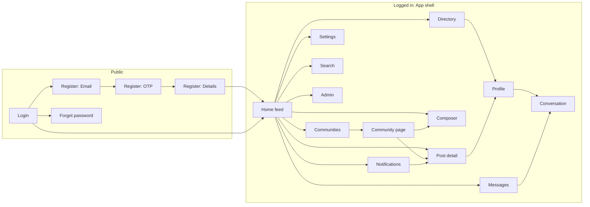
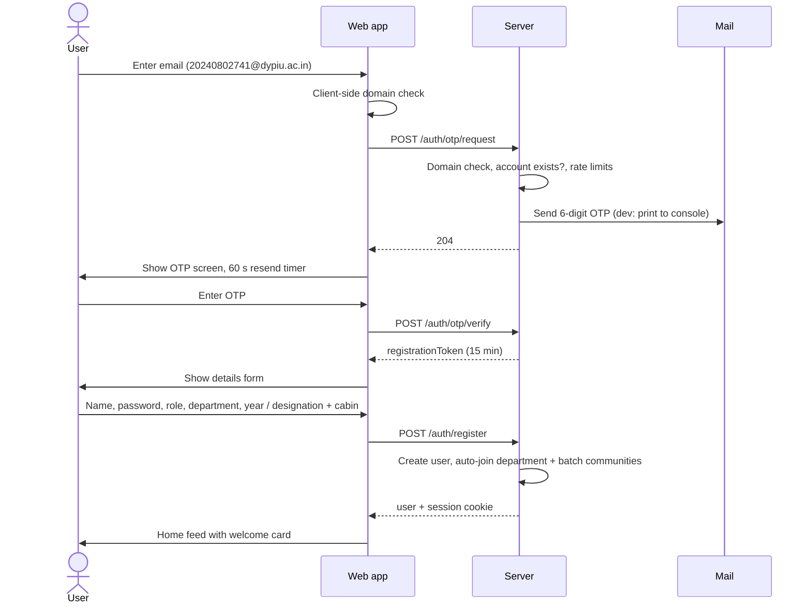
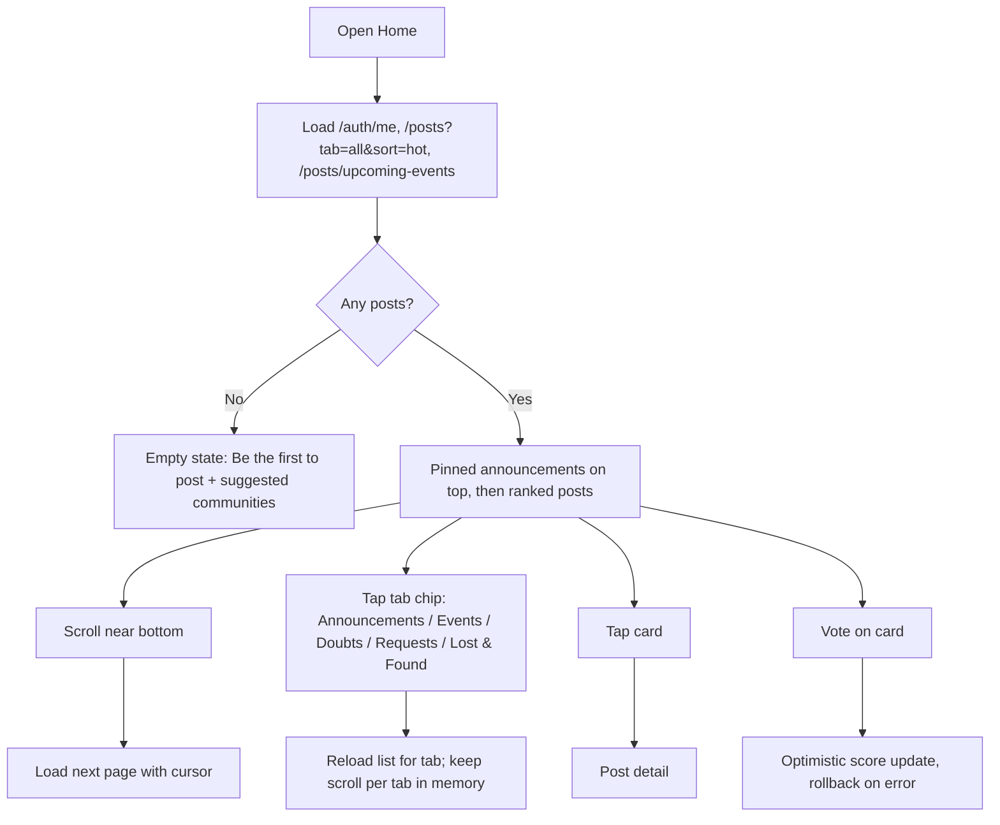
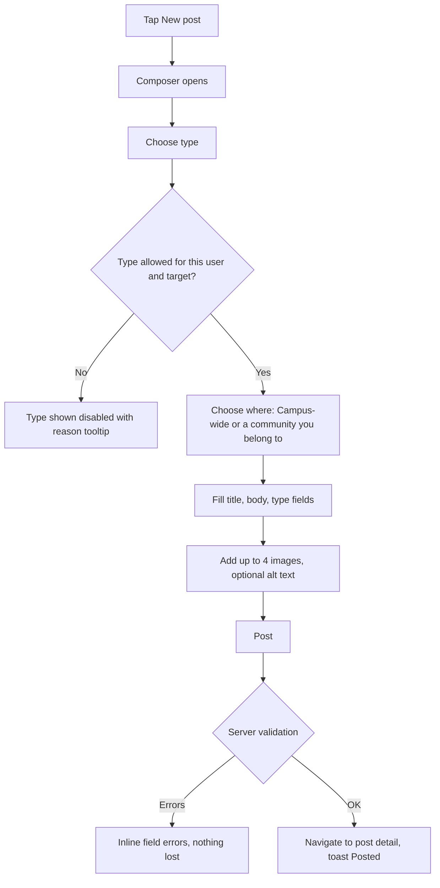
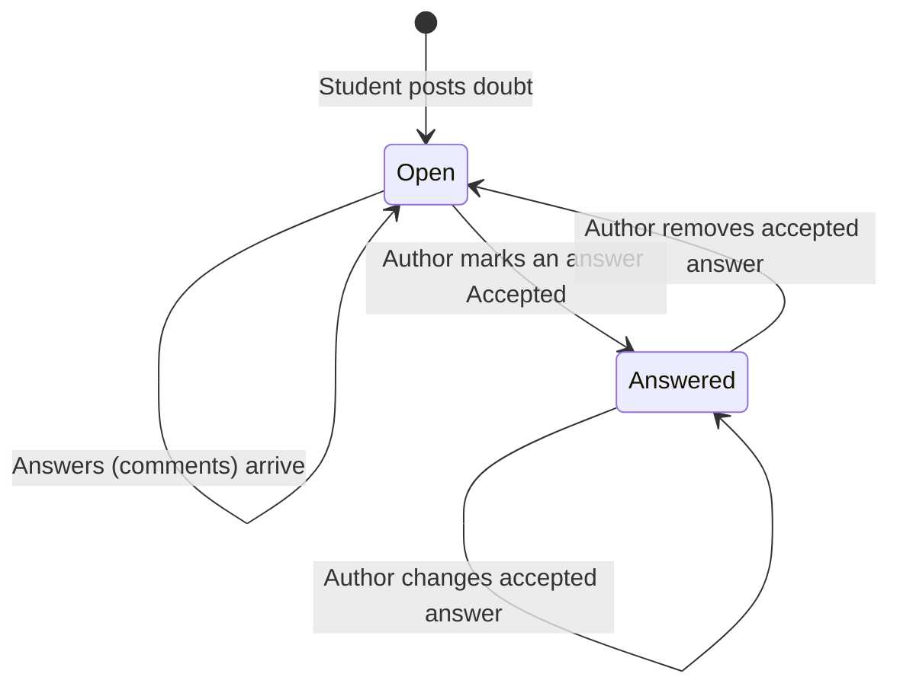
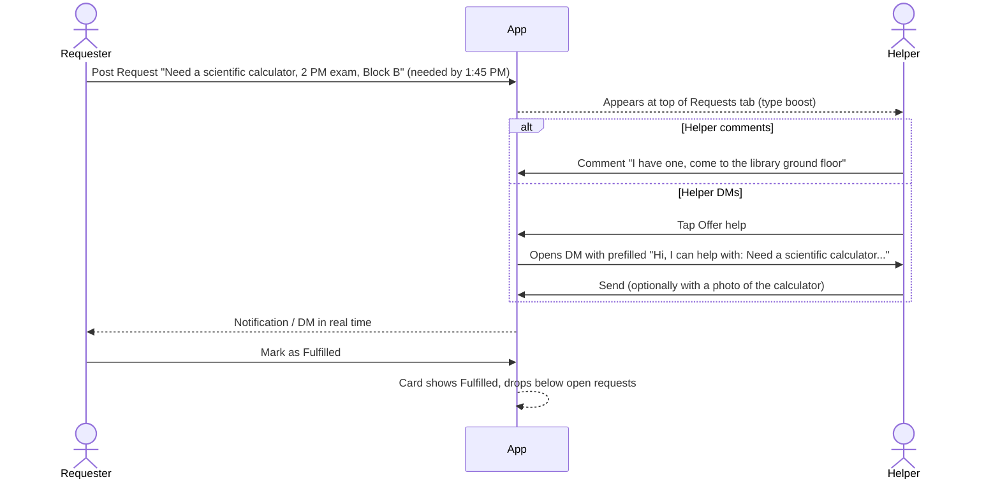
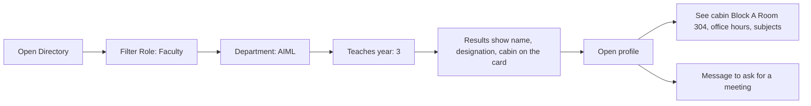

# 03. Application Flow

**Product:** Campus Connect
**Version:** 1.0 (MVP)
**Related:** [01-PRD.md](01-PRD.md), [04-UIUX-BRIEF.md](04-UIUX-BRIEF.md), [02-TRD.md](02-TRD.md)
**Last updated:** 2026-10-11

This document describes every screen, how users move between them, and the step-by-step flow for each feature, including errors and empty states. Diagrams use Mermaid (renders on GitHub and in VS Code with the Mermaid extension).

---

## 1. Screen Inventory

| Route | Screen | Access | Purpose |
|---|---|---|---|
| `/login` | Login | Public | Email + password sign in |
| `/register` | Register (3 steps on one route: Email, Verify, Profile) | Public | Enter college email, enter the 6-digit code, then name, password, role, department, and year or designation and cabin |
| `/forgot-password` | Forgot password | Public | OTP based reset |
| `/` | Home feed | User | Unified campus feed with tabs |
| `/post/:id` | Post detail | User | Full post, comments, accepted answer, RSVP |
| (modal) | Composer (modal on desktop, full screen on mobile), opened from "New post", the Home quick actions, or a community page | User | Create any post type |
| `/communities` | Communities list | User | Discover and join |
| `/c/:slug` | Community page | User | Community feed, about, events, members |
| `/c/:slug` (settings dialog, Members tab) | Community settings | Community admin | Edit name, description, rules, images; change roles in the Members tab |
| `/communities/new` | Create / request community | User | Form |
| `/directory` | Directory | User | Search students and faculty, senior connect panel |
| `/u/:id` | Profile | User | Person's details, posts, communities, Message button |
| `/settings/profile` | Edit profile | User | Edit own profile and avatar |
| `/settings/account` | Account | User | Change password, blocked users, log out |
| `/messages` | Conversations list | User | All DMs |
| `/messages/:conversationId` | Conversation | Participant | Chat with images |
| `/notifications` | Notifications | User | Full list (bell panel shows latest on desktop) |
| `/search?q=` | Search results | User | Posts, people, communities |
| `/admin` | Admin dashboard | Platform admin | Stats, pending faculty, reports, community requests |
| `*` | Not found | Any | Link back home |

---

## 2. Navigation Map



### 2.1 App shell

- **Desktop (1024 px and up):** left sidebar (Home, Communities, Directory, Messages, Notifications, Profile, Admin if admin), top bar (search, "New post" button, bell, avatar menu), center content, right rail (Upcoming events, Pinned announcements, "Your communities").
- **Tablet (768 to 1023 px):** icon-only left sidebar, no right rail (its content moves to the top of Home as a horizontal strip).
- **Mobile (under 768 px):** top bar (logo, search icon, bell), bottom tab bar (Home, Communities, New post, Messages, Directory). Profile and settings via avatar in top bar.

### 2.2 Route guards

| Guard | Rule | On fail |
|---|---|---|
| `RequireAuth` | `GET /api/auth/me` returns a user | Redirect to `/login?next=<path>` |
| `PublicOnly` | No session | Redirect to `/` |
| `RequireAdmin` | `user.role === "admin"` | Show Not found |
| Registration steps | Steps live in component state; a refresh restarts at step 1 | n/a |

---

## 3. Flows

### 3.1 Registration with college email and OTP



**Steps**

1. **Email screen.** Single input, label "College email", placeholder `yourname@dypiu.ac.in`. Button "Send code".
   - Client checks the domain as the user types; the button stays disabled until it matches.
   - Error `INVALID_EMAIL_DOMAIN`: "Use your college email ending in dypiu.ac.in."
   - Error `EMAIL_TAKEN`: "You already have an account." with a "Log in" link pre-filling the email.
   - Error `RATE_LIMITED`: "Too many codes requested. Try again in N minutes."
2. **OTP screen.** Six separate digit boxes, auto-advance, paste of a 6-digit string fills all. Text: "We sent a code to 2024...@dypiu.ac.in. It expires in 10 minutes. Check spam if you don't see it."
   - "Resend code" is disabled with a countdown for 60 seconds.
   - "Wrong email? Change it" goes back to step 1.
   - Wrong code: boxes shake once, "That code is not right. 4 tries left."
   - Locked: "Too many wrong tries. Request a new code."
   - Expired: "This code expired. We can send a new one." with a button.
3. **Details screen.** Sections:
   - "About you": Full name, Password (with show/hide and a strength hint), "I am a" segmented control: Student / Faculty.
   - If Student: Department (select), Program (select), Year (1 to 5), Section (optional).
   - If Faculty: Department, Designation (select with "Other"), Cabin / office location (text, example "Block A, Room 304"), Office hours (optional).
   - Faculty note: "Faculty accounts are verified by the admin before you can post campus announcements. You can use everything else right away."
   - Button "Create account".
4. **Welcome.** Home feed opens with a dismissible welcome card: "You joined AIML and AIML 2024 Batch. Complete your profile so seniors and faculty can find you." with buttons "Complete profile" and "Find communities".

### 3.2 Login and session

1. `/login`: email, password, "Log in". Links: "Create an account", "Forgot password?".
2. Errors: "Email or password is incorrect." (same for both); suspended: "Your account is suspended until 18 Oct 2026. Contact student affairs if you think this is a mistake."
3. On success, redirect to `next` or `/`.
4. Session expiry: any `401` from the API clears auth state and redirects to `/login?next=<current path>` with a toast "Your session ended. Please log in again."
5. Logout from the avatar menu calls `POST /auth/logout` and goes to `/login`.

### 3.3 Forgot password

Email -> OTP (purpose `reset_password`) -> new password twice -> success toast -> login screen. The request step always shows "If an account exists, we sent a code" to avoid revealing which emails are registered.

### 3.4 Browsing the home feed



- Tab-specific sub filters:
  - Doubts: subject chips (from tags in use), toggle "Unanswered only".
  - Lost & Found: segmented "All / Lost / Found", toggle "Show resolved".
  - Requests: toggle "Open only" (default on).
  - Events: "Upcoming" (default) / "Past".
- Sort dropdown: Hot, New, Top this week.
- Returning to the feed from a post restores the scroll position.

### 3.5 Creating a post (any type)



**Type picker** (cards with icon, name, one-line hint):

| Type | Hint shown |
|---|---|
| General | Share something with campus |
| Doubt | Ask an academic question |
| Request | Need to borrow something? |
| Lost | Lost an item on campus |
| Found | Found something that isn't yours |
| Announcement | Official update (faculty, club leads) |
| Event | Workshop, talk, fest, meetup (club leads, faculty) |

**Where to post**: a select listing "Campus-wide" plus the user's communities. Rules:
- Event requires a community where the user is admin or moderator (or the user is a verified teacher/admin, who can pick any community they belong to).
- Campus-wide announcement only for verified teachers and admins.
- Pending teachers see Announcement disabled with "Available after your faculty account is verified."

**Type fields**

| Type | Fields shown |
|---|---|
| Doubt | Subject (combobox with suggestions) |
| Request | Needed by (optional date and time) |
| Lost / Found | Where (text), When (date) |
| Announcement | Pin to top (checkbox, if allowed), Turn off comments (checkbox) |
| Event | Starts (date + time, required), Ends (optional), Venue (required), Registration link (optional), Poster image (first image is used as the poster) |

**Draft safety**: the composer stores a draft in `localStorage` per type every 2 seconds; closing it asks "Discard this post?" if there is content.

### 3.6 Doubt lifecycle



1. Aarav posts a Doubt: title "Why is 3NF not always dependency preserving?", subject "DBMS", a photo of the textbook example.
2. The post appears in Home (All, Doubts) and in the AIML community if posted there.
3. Classmates and seniors answer in comments; a teacher answers with a "Faculty" badge on the comment.
4. Aarav taps "Accept answer" on the most helpful comment. That comment moves directly under the post with a green "Accepted answer" label. The card in the feed shows "Answered".
5. The answer's author gets a notification "Your answer was accepted".

Empty state on a new doubt: "No answers yet. Know the answer? Help a classmate."

### 3.7 Request lifecycle (borrow a calculator)



- If `neededBy` passes while open, the card shows "Expired" and the author sees a prompt "Did you get it? Mark fulfilled or close."

### 3.8 Lost and found lifecycle

1. Riya posts **Lost**: "Blue ID card holder with college ID", Where "Canteen, Block C", When "Today", one photo of a similar holder.
2. Someone who found an item may already have posted **Found**. The Lost & Found tab shows both, open first, so either side can spot a match.
3. The finder comments or uses **Message** from the post author menu, sending a photo of the found item over DM.
4. Riya marks the post **Resolved**. Comments lock; the card shows "Resolved" in green.

Safety copy on Found posts: "Don't post full ID numbers or photos showing personal details. Ask the owner to describe the item."

### 3.9 Teacher announcement

1. Prof. Kulkarni (verified) taps New post -> Announcement -> Where: "Campus-wide" or "AIML 2023 Batch".
2. Writes "Deep Learning lab moved to Lab 3, Block A, this Friday", ticks "Pin to top".
3. On post:
   - Campus-wide: all active users get a notification; the post is pinned on Home for 7 days.
   - Community: members get a notification; pinned at the top of that community.
4. Students see the "Announcement" label and "Assistant Professor, AIML" under the author name.

### 3.10 Club event and RSVP (the GDGC flow)

```mermaid
sequenceDiagram
  actor L as GDGC lead (community admin)
  participant App
  actor S as Any student (not a GDGC member)
  L->>App: New post -> Event -> Where: GDGC DYPIU
  L->>App: Title, poster image, start/end, venue, registration link
  App-->>App: Save event; notify GDGC members
  App-->>S: Event appears in Home > Events tab and the Upcoming events rail
  S->>App: Tap Going
  App-->>S: Button turns Going, count updates
  L->>App: Open post -> RSVP list -> Download CSV
  Note over App: After end time the event moves to Past events
```

- The event card always shows the date block (day number and month), time range, venue, club name, and "86 going".
- The rail on the right shows the next 5 events campus-wide; on mobile it is a horizontal strip at the top of Home.
- RSVP is optimistic; on failure it reverts with a toast.

### 3.11 Communities

**Discover and join**
1. `/communities` shows filter chips (All, Clubs, Departments, Batches, Interest, Official), a search box, and cards with avatar, name, type, member count, and a Join button.
2. Join is instant (204) and the button changes to "Joined". Leaving asks for confirmation.

**Community page** `/c/:slug`
- Header: cover, avatar, name, type badge, member count, Join/Joined, "New post" (members only).
- Tabs: Posts (default), Events (clubs), About (description, rules, admins and moderators), Members.
- Non-members see posts and a banner "Join to post and comment".

**Create or request a community**
1. `/communities/new`: name, slug (auto from name, editable, checked for availability), type (Club / Interest), description, rules, avatar, cover.
2. Verified teacher or admin: created immediately and the creator becomes community admin.
3. Student: "Request sent. An admin will review it." Admin approves -> the student becomes community admin and gets a notification.

**Moderation inside a community**
- Community admins and moderators see a "..." menu on every post in their community with Pin, Lock comments, Remove.
- Members tab lets admins change roles (Member, Moderator, Admin) and remove members.

### 3.12 Directory: finding a teacher's cabin

Scenario: a first-year student wants to meet a third-year AIML teacher.



- Search box matches name, department, subjects, skills, and cabin. Typing "304" finds whoever sits in Room 304.
- Empty result: "No one matches. Try fewer filters." with a "Clear filters" button.

### 3.13 Senior connect

1. Directory has a tab "Seniors open to mentor".
2. Shows students more senior than the viewer with "Open to mentor" on, own department first, filterable by topic (Electives, Internships, Placements, Clubs, Competitive programming, Research, Hostel life).
3. Card shows year, department, topics, and a "Message" button.
4. Message opens a DM with an editable starter: "Hi, I'm a first-year AIML student. Could I ask you about electives?"
5. A senior turns the toggle on in Settings -> Profile -> "Open to mentor juniors" and picks topics.

### 3.14 Direct messages with images

```mermaid
sequenceDiagram
  actor A as Sender
  participant WA as Sender's browser
  participant S as Server
  participant WB as Receiver's browser
  actor B as Receiver
  A->>WA: Type text, attach photo, press Enter
  WA->>WA: Show message instantly as "Sending" (optimistic, local image preview)
  WA->>S: POST /conversations/:id/messages (multipart, clientId)
  S->>S: Validate participant, block, image; save
  S-->>WA: 201 message (replace optimistic copy, mark Sent)
  S-->>WB: socket message:new
  WB->>B: Message appears, unread badge +1
  B->>WB: Opens conversation
  WB->>S: POST /conversations/:id/read
  S-->>WA: socket message:read -> "Seen"
```

**Screen behavior**
- Desktop: two panes (list left, conversation right). Mobile: list, then full-screen conversation with back arrow.
- Composer: text area (Enter sends, Shift+Enter new line), image button (one image, preview chip with remove), Send button.
- Failed send: message stays with "Not sent. Retry" and a retry tap.
- Image messages show a thumbnail (max 280 px wide); tap opens the lightbox.
- Typing indicator below the last message.
- Starting a DM: from a profile, directory card, post author menu, or "Offer help". If a conversation exists it opens; otherwise it is created on first send.
- Blocked: the composer is replaced with "You can't message this person."

Empty states:
- No conversations: "No messages yet. Find someone in the Directory to start a conversation." with a button.
- New conversation: "Say hi to Prof. Kulkarni. Messages are private between you two."

### 3.15 Commenting with an image

1. Under a post, the comment box shows "Add a comment" with an image icon.
2. User types, attaches a screenshot (preview with remove), optional alt text field appears under the preview: "Describe the image (helps screen reader users)".
3. Post comment -> appears at the top (in New sort) or in place (Top sort) with a highlight that fades in 1.5 s.
4. Reply: "Reply" under a comment opens an inline box; replies show indented one level.
5. Errors: file too large -> "Images must be under 5 MB."; wrong type -> "Use a JPG, PNG, WebP, or GIF image."
6. Locked posts show "Comments are turned off" instead of the box. Resolved lost/found posts show "This item has been resolved."

### 3.16 Notifications

1. The bell badge shows the unread count (max display "9+").
2. Desktop: clicking the bell opens a dropdown panel with the latest 20 and "See all" to `/notifications`. Mobile: goes to `/notifications`.
3. Each row: actor avatar, text ("Sneha Patil commented on your doubt"), relative time, unread dot.
4. Click opens the target and marks it read. "Mark all as read" at the top.
5. New notifications arrive over the socket and prepend to the list.

### 3.17 Reporting

1. "..." menu on a post, comment, message, or profile -> Report.
2. Modal: reasons as radio buttons, optional details, "Submit report".
3. Toast: "Thanks. Our moderators will review this." Reporting the same item twice shows "You already reported this."
4. Content with 5 or more open reports is hidden and replaced with "This post is under review."

### 3.18 Admin

`/admin` with tabs:

| Tab | Content | Actions |
|---|---|---|
| Overview | Users, new today, posts today, open reports, pending faculty, pending communities | Links to tabs |
| Pending faculty | Name, email, department, designation, cabin, registered date | Approve, Reject (reason) |
| Reports | Target preview, reason, reporter count, community | Dismiss, Remove content, Suspend 7 / 30 days / permanent |
| Communities | Pending requests with requester and description | Approve, Reject (reason) |

### 3.19 Editing a profile

`/settings/profile`: avatar upload (crop square in browser, P1), name, bio, department, program/year/section or designation/cabin/office hours/subjects, skills (chips), links, "Open to mentor juniors" with topics. "Save changes" shows a toast; leaving with unsaved changes asks for confirmation.

---

## 4. Global States

| State | Behavior |
|---|---|
| Loading (first load) | Skeleton cards matching final layout; no spinners in content areas |
| Loading (more) | Small inline loader at list bottom |
| Offline | Top banner "You're offline. We'll reconnect automatically." Socket reconnects with backoff; on reconnect the open conversation refetches messages after the last known id |
| Server error | Toast "Something went wrong. Try again." with Retry for list loads |
| Not found | "This post was removed or doesn't exist." with "Back to Home" |
| Forbidden | Inline message explaining why (for example "Join GDGC DYPIU to comment") |
| Empty lists | Every list has a specific empty message and a next action (see each flow) |

---

## 5. Real-time Updates Summary

| Where | What updates live |
|---|---|
| Any page | Unread messages badge, notification bell |
| Messages list | Reorders on new message, unread counts |
| Open conversation | New messages, typing, "Seen" |
| Post detail (P1) | RSVP counts |

Feed and comments do not live-update in the MVP; a "New posts" pill appears when the user returns to the tab after 2 minutes, prompting a refresh.

---

## 6. Deep Links

| Link | Opens |
|---|---|
| `/post/42` | Post 42 (redirects to login first if needed, then back) |
| `/post/42#c-310` | Post 42 scrolled to comment 310 with highlight |
| `/c/gdgc` | GDGC community |
| `/c/gdgc?tab=events` | GDGC events tab |
| `/u/7` | Profile of user 7 |
| `/messages/15` | Conversation 15 |
| `/directory?role=teacher&dept=AIML&teachesYear=3` | Pre-filtered directory |
