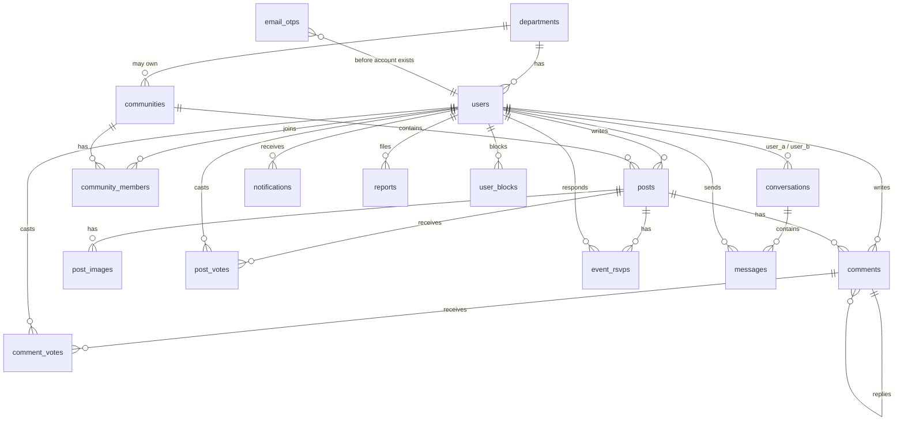

# 05. Backend Schema

**Product:** Campus Connect
**Database:** SQLite 3.45+ via Node's built-in `node:sqlite` (portable to PostgreSQL, see section 9). The executable DDL is `server/db/migrations/001_init.sql`; it matches this document except that role-specific field requirements (program/year for students, designation/cabin for faculty) are enforced in the API instead of table CHECKs, and `users.prior_status` remembers the status to restore after a suspension ends.
**Version:** 1.0 (MVP), schema version `2`
**Related:** [02-TRD.md](02-TRD.md), [07-DATASET-GUIDE.md](07-DATASET-GUIDE.md)
**Last updated:** 2026-10-11

---

## 1. Conventions

| Topic | Rule |
|---|---|
| Table names | Plural `snake_case` (`posts`, `community_members`) |
| Primary keys | `id INTEGER PRIMARY KEY` (SQLite rowid alias), except join tables which use composite keys |
| Foreign keys | `<table_singular>_id`, always declared with `REFERENCES`, `PRAGMA foreign_keys = ON` at every connection |
| Timestamps | `TEXT` in ISO 8601 UTC with milliseconds, default `strftime('%Y-%m-%dT%H:%M:%fZ','now')` |
| Booleans | `INTEGER NOT NULL DEFAULT 0 CHECK (x IN (0,1))` |
| Enums | `TEXT` with `CHECK (col IN (...))` |
| Lists | JSON text arrays (`subjects`, `skills`, `mentor_topics`), validated by the app, read with `json_each` when filtering |
| Soft delete | `deleted_at TEXT NULL` on `posts`, `comments`, `messages`; all reads filter `deleted_at IS NULL` |
| Counters | Denormalized counters (`score`, `comment_count`, `member_count`, `going_count`) are updated in the same transaction as the source row |
| Text limits | Enforced by `CHECK (length(col) <= n)` and again by zod in the API |

Connection pragmas (set in `server/db/index.js`):

```sql
PRAGMA journal_mode = WAL;
PRAGMA synchronous = NORMAL;
PRAGMA foreign_keys = ON;
PRAGMA busy_timeout = 5000;
```

---

## 2. Entity Relationship Diagram



---

## 3. Table Definitions (DDL)

Migration file `server/db/migrations/001_init.sql`.

### 3.1 `schema_migrations`

```sql
CREATE TABLE IF NOT EXISTS schema_migrations (
  version     INTEGER PRIMARY KEY,
  name        TEXT NOT NULL,
  applied_at  TEXT NOT NULL DEFAULT (strftime('%Y-%m-%dT%H:%M:%fZ','now'))
);
```

### 3.2 `departments`

```sql
CREATE TABLE departments (
  id          INTEGER PRIMARY KEY,
  code        TEXT NOT NULL UNIQUE CHECK (length(code) BETWEEN 2 AND 12),   -- 'AIML'
  name        TEXT NOT NULL CHECK (length(name) <= 100),                     -- 'Artificial Intelligence and Machine Learning'
  school      TEXT CHECK (length(school) <= 120),                            -- 'School of Computer Science and Engineering'
  created_at  TEXT NOT NULL DEFAULT (strftime('%Y-%m-%dT%H:%M:%fZ','now'))
);
```

### 3.3 `users`

```sql
CREATE TABLE users (
  id               INTEGER PRIMARY KEY,
  email            TEXT NOT NULL UNIQUE COLLATE NOCASE,
  password_hash    TEXT NOT NULL,
  name             TEXT NOT NULL CHECK (length(name) BETWEEN 2 AND 80),
  role             TEXT NOT NULL CHECK (role IN ('student','teacher','admin')),
  status           TEXT NOT NULL DEFAULT 'active'
                     CHECK (status IN ('active','pending','suspended')),
  suspended_until  TEXT,                                   -- NULL with status 'suspended' = permanent
  avatar_url       TEXT,
  bio              TEXT CHECK (length(bio) <= 300),
  department_id    INTEGER REFERENCES departments(id) ON DELETE SET NULL,

  -- student fields
  program          TEXT CHECK (length(program) <= 40),    -- 'B.Tech'
  year             INTEGER CHECK (year BETWEEN 1 AND 5),
  section          TEXT CHECK (length(section) <= 10),
  graduation_year  INTEGER CHECK (graduation_year BETWEEN 2000 AND 2100),
  enrollment_no    TEXT CHECK (length(enrollment_no) <= 20),   -- private

  -- teacher fields
  designation      TEXT CHECK (length(designation) <= 60),
  office_location  TEXT CHECK (length(office_location) <= 100), -- 'Block A, Room 304'
  office_hours     TEXT CHECK (length(office_hours) <= 120),
  subjects         TEXT NOT NULL DEFAULT '[]',   -- JSON: [{"name":"Deep Learning","year":3}]

  -- shared extras
  skills           TEXT NOT NULL DEFAULT '[]',   -- JSON: ["Python","React"]
  github_url       TEXT CHECK (length(github_url) <= 200),
  linkedin_url     TEXT CHECK (length(linkedin_url) <= 200),
  open_to_mentor   INTEGER NOT NULL DEFAULT 0 CHECK (open_to_mentor IN (0,1)),
  mentor_topics    TEXT NOT NULL DEFAULT '[]',   -- JSON: ["Internships","Electives"]

  last_seen_at     TEXT,
  created_at       TEXT NOT NULL DEFAULT (strftime('%Y-%m-%dT%H:%M:%fZ','now')),
  updated_at       TEXT NOT NULL DEFAULT (strftime('%Y-%m-%dT%H:%M:%fZ','now')),

  CHECK (role <> 'student' OR (program IS NOT NULL AND year IS NOT NULL)),
  CHECK (role <> 'teacher' OR (designation IS NOT NULL AND office_location IS NOT NULL)),
  CHECK (json_valid(subjects) AND json_valid(skills) AND json_valid(mentor_topics))
);

CREATE INDEX idx_users_department ON users(department_id);
CREATE INDEX idx_users_role_status ON users(role, status);
CREATE INDEX idx_users_mentor ON users(open_to_mentor, year) WHERE open_to_mentor = 1;
```

Notes:
- Seed or `ADMIN_EMAILS` sets `role = 'admin'`. Admins may also have student or teacher fields filled; the two role checks then do not apply.
- A teacher registers with `status = 'pending'`. Approval sets `active`.
- `graduation_year` is computed at registration: `current academic start year + (program length - year + 1)`.

### 3.4 `email_otps`

```sql
CREATE TABLE email_otps (
  id           INTEGER PRIMARY KEY,
  email        TEXT NOT NULL COLLATE NOCASE,
  purpose      TEXT NOT NULL CHECK (purpose IN ('register','reset_password')),
  code_hash    TEXT NOT NULL,                    -- sha256 hex
  attempts     INTEGER NOT NULL DEFAULT 0,
  expires_at   TEXT NOT NULL,
  consumed_at  TEXT,
  request_ip   TEXT,
  created_at   TEXT NOT NULL DEFAULT (strftime('%Y-%m-%dT%H:%M:%fZ','now'))
);

CREATE INDEX idx_otps_email_created ON email_otps(email, purpose, created_at);
```

Rows older than 24 hours are deleted by a cleanup job on server start and every hour.

### 3.5 `communities`

```sql
CREATE TABLE communities (
  id              INTEGER PRIMARY KEY,
  slug            TEXT NOT NULL UNIQUE COLLATE NOCASE
                    CHECK (slug GLOB '[a-z0-9]*' AND length(slug) BETWEEN 2 AND 40
                           AND slug NOT GLOB '*[^a-z0-9-]*'),
  name            TEXT NOT NULL CHECK (length(name) BETWEEN 2 AND 60),
  description     TEXT CHECK (length(description) <= 500),
  rules           TEXT CHECK (length(rules) <= 2000),
  type            TEXT NOT NULL CHECK (type IN ('official','department','batch','club','interest')),
  department_id   INTEGER REFERENCES departments(id) ON DELETE SET NULL,
  graduation_year INTEGER,                         -- for batch communities
  avatar_url      TEXT,
  cover_url       TEXT,
  status          TEXT NOT NULL DEFAULT 'active' CHECK (status IN ('active','pending','rejected','archived')),
  is_verified     INTEGER NOT NULL DEFAULT 0 CHECK (is_verified IN (0,1)),
  auto_join       INTEGER NOT NULL DEFAULT 0 CHECK (auto_join IN (0,1)),  -- official: everyone joins
  member_count    INTEGER NOT NULL DEFAULT 0,
  created_by      INTEGER REFERENCES users(id) ON DELETE SET NULL,
  reviewed_by     INTEGER REFERENCES users(id) ON DELETE SET NULL,
  review_note     TEXT,
  created_at      TEXT NOT NULL DEFAULT (strftime('%Y-%m-%dT%H:%M:%fZ','now')),
  updated_at      TEXT NOT NULL DEFAULT (strftime('%Y-%m-%dT%H:%M:%fZ','now')),

  CHECK (type <> 'batch' OR (department_id IS NOT NULL AND graduation_year IS NOT NULL))
);

CREATE INDEX idx_communities_type_status ON communities(type, status);
CREATE UNIQUE INDEX uq_batch ON communities(department_id, graduation_year) WHERE type = 'batch';
```

### 3.6 `community_members`

```sql
CREATE TABLE community_members (
  community_id  INTEGER NOT NULL REFERENCES communities(id) ON DELETE CASCADE,
  user_id       INTEGER NOT NULL REFERENCES users(id) ON DELETE CASCADE,
  role          TEXT NOT NULL DEFAULT 'member' CHECK (role IN ('member','moderator','admin')),
  joined_at     TEXT NOT NULL DEFAULT (strftime('%Y-%m-%dT%H:%M:%fZ','now')),
  PRIMARY KEY (community_id, user_id)
) WITHOUT ROWID;

CREATE INDEX idx_members_user ON community_members(user_id);
CREATE INDEX idx_members_role ON community_members(community_id, role) WHERE role <> 'member';
```

### 3.7 `posts`

```sql
CREATE TABLE posts (
  id                   INTEGER PRIMARY KEY,
  author_id            INTEGER NOT NULL REFERENCES users(id) ON DELETE CASCADE,
  community_id         INTEGER REFERENCES communities(id) ON DELETE CASCADE,   -- NULL = campus-wide
  type                 TEXT NOT NULL CHECK (type IN
                         ('general','doubt','request','lost','found','announcement','event')),
  title                TEXT NOT NULL CHECK (length(title) BETWEEN 3 AND 150),
  body                 TEXT NOT NULL DEFAULT '' CHECK (length(body) <= 5000),
  status               TEXT NOT NULL DEFAULT 'open' CHECK (status IN ('open','resolved')),
  resolved_at          TEXT,

  -- doubt
  subject_tag          TEXT CHECK (length(subject_tag) <= 30),
  accepted_comment_id  INTEGER REFERENCES comments(id) ON DELETE SET NULL,

  -- request
  needed_by            TEXT,

  -- lost / found
  item_location        TEXT CHECK (length(item_location) <= 100),
  item_date            TEXT,                                  -- 'YYYY-MM-DD'

  -- event
  event_starts_at      TEXT,
  event_ends_at        TEXT,
  event_venue          TEXT CHECK (length(event_venue) <= 120),
  event_url            TEXT CHECK (length(event_url) <= 300),
  going_count          INTEGER NOT NULL DEFAULT 0,
  interested_count     INTEGER NOT NULL DEFAULT 0,

  -- moderation and display
  is_pinned            INTEGER NOT NULL DEFAULT 0 CHECK (is_pinned IN (0,1)),
  pinned_until         TEXT,
  comments_locked      INTEGER NOT NULL DEFAULT 0 CHECK (comments_locked IN (0,1)),
  is_hidden            INTEGER NOT NULL DEFAULT 0 CHECK (is_hidden IN (0,1)),  -- auto-hidden by reports

  score                INTEGER NOT NULL DEFAULT 0,
  comment_count        INTEGER NOT NULL DEFAULT 0,
  created_at           TEXT NOT NULL DEFAULT (strftime('%Y-%m-%dT%H:%M:%fZ','now')),
  edited_at            TEXT,
  deleted_at           TEXT,

  CHECK (type <> 'doubt' OR subject_tag IS NOT NULL),
  CHECK (type NOT IN ('lost','found') OR (item_location IS NOT NULL AND item_date IS NOT NULL)),
  CHECK (type <> 'event' OR (community_id IS NOT NULL AND event_starts_at IS NOT NULL AND event_venue IS NOT NULL)),
  CHECK (event_ends_at IS NULL OR event_ends_at > event_starts_at),
  CHECK (status = 'open' OR type IN ('doubt','request','lost','found'))
);

CREATE INDEX idx_posts_feed_new   ON posts(created_at DESC, id DESC) WHERE deleted_at IS NULL AND is_hidden = 0;
CREATE INDEX idx_posts_type_new   ON posts(type, created_at DESC) WHERE deleted_at IS NULL AND is_hidden = 0;
CREATE INDEX idx_posts_community  ON posts(community_id, created_at DESC) WHERE deleted_at IS NULL;
CREATE INDEX idx_posts_author     ON posts(author_id, created_at DESC);
CREATE INDEX idx_posts_events     ON posts(event_starts_at) WHERE type = 'event' AND deleted_at IS NULL;
CREATE INDEX idx_posts_pinned     ON posts(is_pinned, pinned_until) WHERE is_pinned = 1;
CREATE INDEX idx_posts_subject    ON posts(subject_tag) WHERE type = 'doubt';
```

`accepted_comment_id` references `comments`, which is created after `posts`. SQLite allows this forward reference because foreign keys are checked at write time, not at `CREATE TABLE` time.

"Doubt answered" is derived: `type = 'doubt' AND accepted_comment_id IS NOT NULL` sets `status = 'resolved'` in the same transaction as the accept action.

### 3.8 `post_images`

```sql
CREATE TABLE post_images (
  id          INTEGER PRIMARY KEY,
  post_id     INTEGER NOT NULL REFERENCES posts(id) ON DELETE CASCADE,
  url         TEXT NOT NULL,
  alt_text    TEXT CHECK (length(alt_text) <= 200),
  width       INTEGER,
  height      INTEGER,
  bytes       INTEGER,
  position    INTEGER NOT NULL CHECK (position BETWEEN 0 AND 3),
  UNIQUE (post_id, position)
);
```

### 3.9 `post_votes`

```sql
CREATE TABLE post_votes (
  post_id     INTEGER NOT NULL REFERENCES posts(id) ON DELETE CASCADE,
  user_id     INTEGER NOT NULL REFERENCES users(id) ON DELETE CASCADE,
  value       INTEGER NOT NULL CHECK (value IN (-1, 1)),
  created_at  TEXT NOT NULL DEFAULT (strftime('%Y-%m-%dT%H:%M:%fZ','now')),
  PRIMARY KEY (post_id, user_id)
) WITHOUT ROWID;

CREATE INDEX idx_post_votes_user ON post_votes(user_id);
```

Vote change algorithm (one transaction): read old value (0 if none) -> upsert or delete -> `UPDATE posts SET score = score + (new - old)`.

### 3.10 `comments`

```sql
CREATE TABLE comments (
  id          INTEGER PRIMARY KEY,
  post_id     INTEGER NOT NULL REFERENCES posts(id) ON DELETE CASCADE,
  author_id   INTEGER NOT NULL REFERENCES users(id) ON DELETE CASCADE,
  parent_id   INTEGER REFERENCES comments(id) ON DELETE CASCADE,
  depth       INTEGER NOT NULL DEFAULT 0 CHECK (depth IN (0, 1)),
  body        TEXT NOT NULL DEFAULT '' CHECK (length(body) <= 2000),
  image_url   TEXT,
  image_alt   TEXT CHECK (length(image_alt) <= 200),
  score       INTEGER NOT NULL DEFAULT 0,
  is_hidden   INTEGER NOT NULL DEFAULT 0 CHECK (is_hidden IN (0,1)),
  created_at  TEXT NOT NULL DEFAULT (strftime('%Y-%m-%dT%H:%M:%fZ','now')),
  edited_at   TEXT,
  deleted_at  TEXT,
  CHECK (length(body) > 0 OR image_url IS NOT NULL),
  CHECK ((parent_id IS NULL AND depth = 0) OR (parent_id IS NOT NULL AND depth = 1))
);

CREATE INDEX idx_comments_post   ON comments(post_id, created_at);
CREATE INDEX idx_comments_author ON comments(author_id, created_at DESC);
CREATE INDEX idx_comments_parent ON comments(parent_id);
```

Reply to a depth-1 comment: the API sets `parent_id` to that comment's parent (keeping depth 1) and prefixes the body with `@Name `.

### 3.11 `comment_votes`

```sql
CREATE TABLE comment_votes (
  comment_id  INTEGER NOT NULL REFERENCES comments(id) ON DELETE CASCADE,
  user_id     INTEGER NOT NULL REFERENCES users(id) ON DELETE CASCADE,
  value       INTEGER NOT NULL CHECK (value IN (-1, 1)),
  created_at  TEXT NOT NULL DEFAULT (strftime('%Y-%m-%dT%H:%M:%fZ','now')),
  PRIMARY KEY (comment_id, user_id)
) WITHOUT ROWID;
```

### 3.12 `event_rsvps`

```sql
CREATE TABLE event_rsvps (
  post_id     INTEGER NOT NULL REFERENCES posts(id) ON DELETE CASCADE,
  user_id     INTEGER NOT NULL REFERENCES users(id) ON DELETE CASCADE,
  status      TEXT NOT NULL CHECK (status IN ('going','interested')),
  created_at  TEXT NOT NULL DEFAULT (strftime('%Y-%m-%dT%H:%M:%fZ','now')),
  updated_at  TEXT NOT NULL DEFAULT (strftime('%Y-%m-%dT%H:%M:%fZ','now')),
  PRIMARY KEY (post_id, user_id)
) WITHOUT ROWID;

CREATE INDEX idx_rsvps_user ON event_rsvps(user_id);
```

### 3.13 `conversations`

```sql
CREATE TABLE conversations (
  id                     INTEGER PRIMARY KEY,
  user_a_id              INTEGER NOT NULL REFERENCES users(id) ON DELETE CASCADE,
  user_b_id              INTEGER NOT NULL REFERENCES users(id) ON DELETE CASCADE,
  user_a_last_read_id    INTEGER NOT NULL DEFAULT 0,
  user_b_last_read_id    INTEGER NOT NULL DEFAULT 0,
  last_message_id        INTEGER,
  last_message_at        TEXT,
  created_at             TEXT NOT NULL DEFAULT (strftime('%Y-%m-%dT%H:%M:%fZ','now')),
  CHECK (user_a_id < user_b_id),
  UNIQUE (user_a_id, user_b_id)
);

CREATE INDEX idx_conv_a ON conversations(user_a_id, last_message_at DESC);
CREATE INDEX idx_conv_b ON conversations(user_b_id, last_message_at DESC);
```

The pair is always stored with the smaller id in `user_a_id`, so "get or create" is a single lookup on `(min(x,y), max(x,y))`.

### 3.14 `messages`

```sql
CREATE TABLE messages (
  id               INTEGER PRIMARY KEY,
  conversation_id  INTEGER NOT NULL REFERENCES conversations(id) ON DELETE CASCADE,
  sender_id        INTEGER NOT NULL REFERENCES users(id) ON DELETE CASCADE,
  body             TEXT NOT NULL DEFAULT '' CHECK (length(body) <= 2000),
  image_url        TEXT,
  client_id        TEXT CHECK (length(client_id) <= 64),
  created_at       TEXT NOT NULL DEFAULT (strftime('%Y-%m-%dT%H:%M:%fZ','now')),
  deleted_at       TEXT,
  CHECK (length(body) > 0 OR image_url IS NOT NULL),
  UNIQUE (sender_id, client_id)          -- makes retries idempotent
);

CREATE INDEX idx_messages_conv ON messages(conversation_id, id DESC);
```

### 3.15 `user_blocks`

```sql
CREATE TABLE user_blocks (
  blocker_id  INTEGER NOT NULL REFERENCES users(id) ON DELETE CASCADE,
  blocked_id  INTEGER NOT NULL REFERENCES users(id) ON DELETE CASCADE,
  created_at  TEXT NOT NULL DEFAULT (strftime('%Y-%m-%dT%H:%M:%fZ','now')),
  PRIMARY KEY (blocker_id, blocked_id),
  CHECK (blocker_id <> blocked_id)
) WITHOUT ROWID;

CREATE INDEX idx_blocks_blocked ON user_blocks(blocked_id);
```

### 3.16 `notifications`

```sql
CREATE TABLE notifications (
  id            INTEGER PRIMARY KEY,
  user_id       INTEGER NOT NULL REFERENCES users(id) ON DELETE CASCADE,
  type          TEXT NOT NULL CHECK (type IN (
                  'post_comment','comment_reply','answer_accepted',
                  'announcement','community_announcement','community_event',
                  'teacher_approved','teacher_rejected',
                  'community_approved','community_rejected',
                  'content_removed')),
  actor_id      INTEGER REFERENCES users(id) ON DELETE SET NULL,
  actor_count   INTEGER NOT NULL DEFAULT 1,        -- collapsed "and 3 others"
  post_id       INTEGER REFERENCES posts(id) ON DELETE CASCADE,
  comment_id    INTEGER REFERENCES comments(id) ON DELETE CASCADE,
  community_id  INTEGER REFERENCES communities(id) ON DELETE CASCADE,
  data          TEXT NOT NULL DEFAULT '{}' CHECK (json_valid(data)),
  read_at       TEXT,
  created_at    TEXT NOT NULL DEFAULT (strftime('%Y-%m-%dT%H:%M:%fZ','now')),
  updated_at    TEXT NOT NULL DEFAULT (strftime('%Y-%m-%dT%H:%M:%fZ','now'))
);

CREATE INDEX idx_notif_user ON notifications(user_id, updated_at DESC);
CREATE INDEX idx_notif_unread ON notifications(user_id) WHERE read_at IS NULL;
```

### 3.17 `reports`

```sql
CREATE TABLE reports (
  id            INTEGER PRIMARY KEY,
  reporter_id   INTEGER NOT NULL REFERENCES users(id) ON DELETE CASCADE,
  target_type   TEXT NOT NULL CHECK (target_type IN ('post','comment','message','user')),
  target_id     INTEGER NOT NULL,
  community_id  INTEGER REFERENCES communities(id) ON DELETE SET NULL,  -- for moderator queues
  reason        TEXT NOT NULL CHECK (reason IN ('spam','harassment','inappropriate','misinformation','other')),
  details       TEXT CHECK (length(details) <= 500),
  status        TEXT NOT NULL DEFAULT 'open' CHECK (status IN ('open','actioned','dismissed')),
  resolved_by   INTEGER REFERENCES users(id) ON DELETE SET NULL,
  resolution    TEXT CHECK (resolution IN ('dismiss','remove','suspend')),
  resolved_at   TEXT,
  created_at    TEXT NOT NULL DEFAULT (strftime('%Y-%m-%dT%H:%M:%fZ','now'))
);

CREATE INDEX idx_reports_status ON reports(status, created_at DESC);
CREATE INDEX idx_reports_target ON reports(target_type, target_id);
CREATE UNIQUE INDEX uq_reports_open ON reports(reporter_id, target_type, target_id) WHERE status = 'open';
```

`target_id` is polymorphic and therefore not a foreign key. The admin route resolves it per `target_type` and shows "Content no longer exists" if missing.

---

## 4. Full-Text Search

Migration `002_fts.sql`.

```sql
CREATE VIRTUAL TABLE posts_fts USING fts5(
  title, body, subject_tag,
  content = 'posts', content_rowid = 'id',
  tokenize = 'unicode61 remove_diacritics 2'
);

CREATE TRIGGER posts_ai AFTER INSERT ON posts BEGIN
  INSERT INTO posts_fts(rowid, title, body, subject_tag)
  VALUES (new.id, new.title, new.body, coalesce(new.subject_tag, ''));
END;

CREATE TRIGGER posts_ad AFTER DELETE ON posts BEGIN
  INSERT INTO posts_fts(posts_fts, rowid, title, body, subject_tag)
  VALUES ('delete', old.id, old.title, old.body, coalesce(old.subject_tag, ''));
END;

CREATE TRIGGER posts_au AFTER UPDATE OF title, body, subject_tag ON posts BEGIN
  INSERT INTO posts_fts(posts_fts, rowid, title, body, subject_tag)
  VALUES ('delete', old.id, old.title, old.body, coalesce(old.subject_tag, ''));
  INSERT INTO posts_fts(rowid, title, body, subject_tag)
  VALUES (new.id, new.title, new.body, coalesce(new.subject_tag, ''));
END;

-- People search: a standalone FTS table maintained by the app on user insert/update,
-- because it combines users with departments.name.
CREATE VIRTUAL TABLE users_fts USING fts5(
  name, department, designation, office_location, subjects, skills,
  tokenize = 'unicode61 remove_diacritics 2'
);
```

The app calls `reindexUser(userId)` after register and profile updates: `DELETE FROM users_fts WHERE rowid = ?` then insert with `rowid = users.id`.

---

## 5. Enum Reference

| Column | Values |
|---|---|
| `users.role` | `student`, `teacher`, `admin` |
| `users.status` | `active`, `pending`, `suspended` |
| `communities.type` | `official`, `department`, `batch`, `club`, `interest` |
| `communities.status` | `active`, `pending`, `rejected`, `archived` |
| `community_members.role` | `member`, `moderator`, `admin` |
| `posts.type` | `general`, `doubt`, `request`, `lost`, `found`, `announcement`, `event` |
| `posts.status` | `open`, `resolved` |
| `event_rsvps.status` | `going`, `interested` |
| `email_otps.purpose` | `register`, `reset_password` |
| `reports.target_type` | `post`, `comment`, `message`, `user` |
| `reports.reason` | `spam`, `harassment`, `inappropriate`, `misinformation`, `other` |
| `reports.status` | `open`, `actioned`, `dismissed` |
| `notifications.type` | see table 3.16 |

Display mapping of `posts.status` per type: doubt resolved = "Answered", request resolved = "Fulfilled", lost/found resolved = "Resolved".

---

## 6. Key Queries

### 6.1 Feed, "New" sort, Doubts tab, page after a cursor

```sql
SELECT p.*, u.name AS author_name, u.avatar_url AS author_avatar, u.role AS author_role,
       u.status AS author_status, c.slug AS community_slug, c.name AS community_name, c.type AS community_type
FROM posts p
JOIN users u ON u.id = p.author_id
LEFT JOIN communities c ON c.id = p.community_id
WHERE p.deleted_at IS NULL
  AND p.is_hidden = 0
  AND p.type = 'doubt'
  AND (c.id IS NULL OR c.status = 'active')
  AND (p.created_at, p.id) < (:cursorCreatedAt, :cursorId)
ORDER BY p.created_at DESC, p.id DESC
LIMIT :limit;
```

Then, for the returned ids:

```sql
SELECT post_id, url, alt_text, width, height, position FROM post_images WHERE post_id IN (/* ids */) ORDER BY post_id, position;
SELECT post_id, value FROM post_votes WHERE user_id = :me AND post_id IN (/* ids */);
SELECT post_id, status FROM event_rsvps WHERE user_id = :me AND post_id IN (/* ids */);
```

### 6.2 Upcoming events rail

```sql
SELECT p.id, p.title, p.event_starts_at, p.event_venue, p.going_count, c.name AS community_name, c.slug
FROM posts p JOIN communities c ON c.id = p.community_id
WHERE p.type = 'event' AND p.deleted_at IS NULL AND p.is_hidden = 0
  AND coalesce(p.event_ends_at, p.event_starts_at) >= strftime('%Y-%m-%dT%H:%M:%fZ','now')
ORDER BY p.event_starts_at ASC
LIMIT 5;
```

### 6.3 Pinned campus announcements

```sql
SELECT * FROM posts
WHERE is_pinned = 1 AND community_id IS NULL AND deleted_at IS NULL
  AND (pinned_until IS NULL OR pinned_until > strftime('%Y-%m-%dT%H:%M:%fZ','now'))
ORDER BY created_at DESC LIMIT 3;
```

### 6.4 Directory: AIML faculty teaching year 3

```sql
SELECT u.id, u.name, u.avatar_url, u.designation, u.office_location, u.office_hours, d.code, d.name AS department
FROM users u
JOIN departments d ON d.id = u.department_id
WHERE u.role = 'teacher' AND u.status = 'active'
  AND d.code = 'AIML'
  AND EXISTS (SELECT 1 FROM json_each(u.subjects) s WHERE json_extract(s.value, '$.year') = 3)
ORDER BY u.name
LIMIT 24;
```

### 6.5 Seniors open to mentor for a viewer

```sql
SELECT u.*, (u.department_id = :viewerDept) AS same_dept
FROM users u
WHERE u.role = 'student' AND u.status = 'active'
  AND u.open_to_mentor = 1 AND u.year > :viewerYear
  AND u.id NOT IN (SELECT blocked_id FROM user_blocks WHERE blocker_id = :me)
  AND u.id NOT IN (SELECT blocker_id FROM user_blocks WHERE blocked_id = :me)
ORDER BY same_dept DESC, u.year DESC, u.name
LIMIT 24;
```

### 6.6 Conversation list with unread counts

```sql
SELECT cv.id, cv.last_message_at,
       CASE WHEN cv.user_a_id = :me THEN cv.user_b_id ELSE cv.user_a_id END AS other_id,
       m.body AS last_body, (m.image_url IS NOT NULL) AS last_has_image, m.sender_id AS last_sender_id,
       (SELECT count(*) FROM messages mm
         WHERE mm.conversation_id = cv.id AND mm.deleted_at IS NULL AND mm.sender_id <> :me
           AND mm.id > CASE WHEN cv.user_a_id = :me THEN cv.user_a_last_read_id ELSE cv.user_b_last_read_id END
       ) AS unread_count
FROM conversations cv
LEFT JOIN messages m ON m.id = cv.last_message_id
WHERE (cv.user_a_id = :me OR cv.user_b_id = :me) AND cv.last_message_id IS NOT NULL
ORDER BY cv.last_message_at DESC;
```

### 6.7 Post search

```sql
SELECT p.id, p.title, p.type, bm25(posts_fts, 10.0, 1.0, 4.0) AS rank
FROM posts_fts JOIN posts p ON p.id = posts_fts.rowid
WHERE posts_fts MATCH :ftsQuery        -- built as '"dbms"* "normal"*'
  AND p.deleted_at IS NULL AND p.is_hidden = 0
ORDER BY rank LIMIT 5;
```

---

## 7. Transactions and Invariants

| Operation | Done in one transaction |
|---|---|
| Register | Insert user, insert `users_fts`, join department, batch, and official communities, bump their `member_count` |
| Create post | Insert post, insert images, (for announcements/events) insert notifications |
| Delete post | Set `deleted_at`, clear pin, decrement nothing (counts are for live rows only through queries) |
| Comment | Insert comment, `posts.comment_count + 1`, notification |
| Delete comment | Set `deleted_at`, `posts.comment_count - 1`, if it was the accepted answer set `accepted_comment_id = NULL` and `status = 'open'` |
| Vote | Upsert/delete vote row, adjust `score` by delta |
| RSVP | Upsert/delete RSVP row, adjust `going_count` / `interested_count` by deltas |
| Join / leave | Insert/delete membership, adjust `member_count` |
| Send message | Insert message, update `conversations.last_message_id/at`, set sender's `last_read_id` to the new id |
| Resolve report with remove | Soft delete target, mark all open reports on the same target `actioned`, notify author |

Invariants checked by a `npm run db:check` script (P1): `posts.comment_count` equals live comment count; `score` equals sum of votes; `member_count` equals membership rows.

---

## 8. Migrations and Seeding

- Migrations are numbered SQL files in `server/db/migrations/` (`001_init.sql`, `002_fts.sql`, ...).
- On startup, `db/index.js` reads `schema_migrations`, runs missing files in order inside a transaction each, and records them.
- Never edit an applied migration; add a new one.
- `npm run db:reset` deletes the database file and re-runs migrations (development only, refuses when `NODE_ENV=production`).
- `npm run seed` loads JSON from `server/seed/` (see [07-DATASET-GUIDE.md](07-DATASET-GUIDE.md)).

---

## 9. PostgreSQL Portability Notes

| SQLite | PostgreSQL |
|---|---|
| `INTEGER PRIMARY KEY` | `BIGINT GENERATED ALWAYS AS IDENTITY PRIMARY KEY` |
| `TEXT` timestamps | `TIMESTAMPTZ` with `DEFAULT now()` |
| `CHECK (col IN (...))` | Same, or native `ENUM` types |
| JSON text + `json_each` | `JSONB` + `jsonb_array_elements` |
| `COLLATE NOCASE` on email | `CITEXT` extension or `lower(email)` unique index |
| FTS5 | `tsvector` generated columns + GIN indexes |
| Partial indexes | Supported identically |
| `WITHOUT ROWID` | Drop (not needed) |

---

## 10. Data Retention

| Data | Retention |
|---|---|
| Soft-deleted posts, comments, messages | Purged after 30 days (daily job), images deleted from storage |
| OTP rows | 24 hours |
| Read notifications | 90 days |
| Resolved reports | 1 year |
| Suspended accounts | Kept; admin can permanently delete on request |
| Account deletion (user request) | Profile anonymized to "Deleted user", messages kept for the other participant, posts kept with author shown as "Deleted user" unless the user asks for removal |
