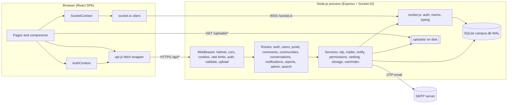
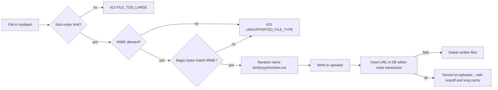
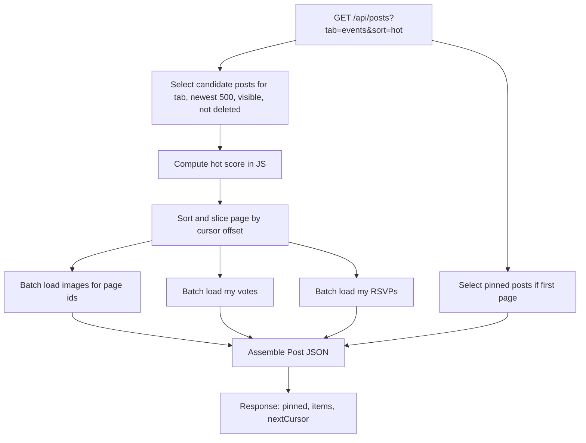
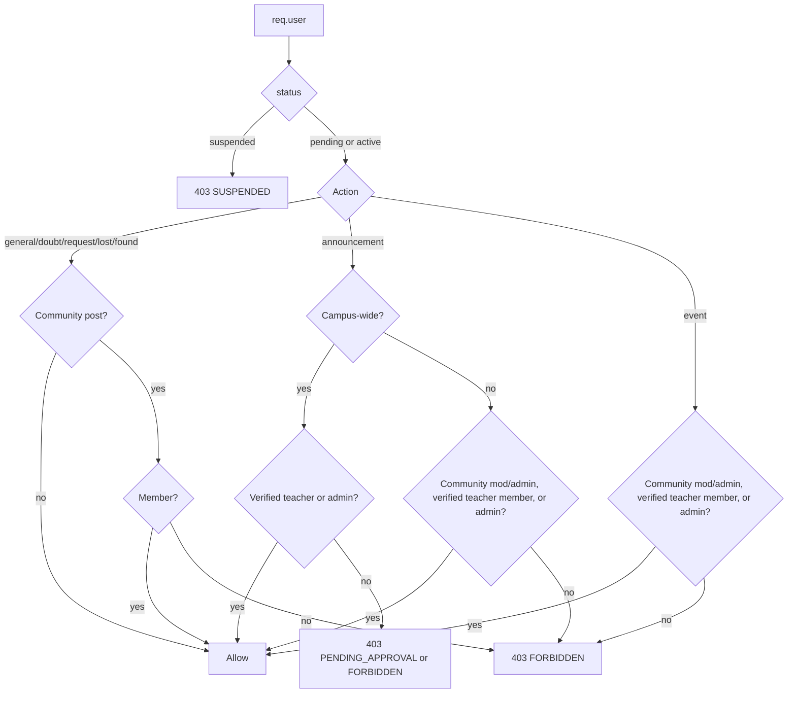
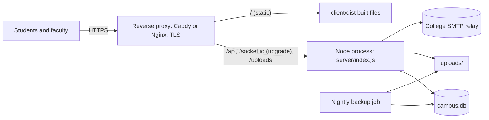
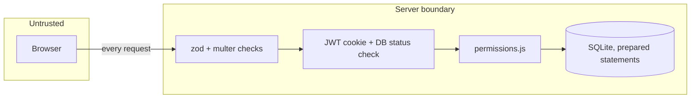

# Architecture

**Product:** Campus Connect
**Version:** 1.0 (MVP)
**Related:** [02-TRD.md](02-TRD.md), [05-BACKEND-SCHEMA.md](05-BACKEND-SCHEMA.md)
**Last updated:** 2026-10-11

---

## 1. Overview

Campus Connect is a single-page web application backed by one Node.js process that serves a REST API, a Socket.IO real-time channel, and uploaded images, with a SQLite database file on local disk. This "modular monolith" is deliberately simple: one deployable unit, one database, no external services required except SMTP for OTP emails.



---

## 2. Components

### 2.1 Client

| Module | Responsibility |
|---|---|
| `App.jsx` | Router, route guards, lazy-loaded pages |
| `context/AuthContext` | Holds `me`, `permissions`, unread counts; exposes `login`, `logout`, `refresh` |
| `context/SocketContext` | Connects after login, disconnects on logout; dispatches `message:new`, `notification:new`, `typing`, `message:read` to subscribers; keeps badge counts |
| `lib/api.js` | `fetch` with `credentials: 'include'`, JSON and `FormData` bodies, maps error JSON to `ApiError`, handles `401` redirect |
| `components/layout/*` | App shell (sidebar, top bar, rail, mobile tab bar) |
| `components/post/*`, `composer/*`, `comments/*`, `events/*`, `media/*`, `users/*`, `notifications/*` | Feature UI |
| `pages/*` | One file per route |

State management is React state plus context; no Redux. Server data is fetched per page with small custom hooks (`usePaged`, `useFetch`) that handle loading, error, cursor paging, and optimistic updates.

### 2.2 Server

| Layer | Responsibility | Rules |
|---|---|---|
| Middleware | Cross-cutting: security headers, CORS, cookies, logging, rate limiting, auth, body validation, uploads | Stateless; no business logic |
| Routes | HTTP shape: parse, call services/queries, return JSON | Thin; every route declares its auth and validation |
| Services | Business rules: permissions, OTP, notifications, ranking, storage, search indexing | Pure functions where possible; take `db` and data, return data |
| Data access | Prepared statements grouped per feature (`postQueries.js`, ...) | All SQL lives here or in migrations |
| Socket | Authenticated real-time delivery | Only relays and pushes; message persistence goes through the HTTP route |

### 2.3 Storage

| Store | Content | Notes |
|---|---|---|
| `server/data/campus.db` | All relational data | WAL mode; back up safely while running with `VACUUM INTO` (see section 9) |
| `server/uploads/` | Images under `posts/`, `comments/`, `messages/`, `avatars/`, `communities/` | Random filenames, year/month folders |

---

## 3. Request Lifecycle (REST)

```mermaid
sequenceDiagram
  participant B as Browser
  participant E as Express
  participant A as requireAuth
  participant V as validate(zod)
  participant R as Route handler
  participant P as permissions
  participant D as SQLite
  B->>E: POST /api/posts (cookie, multipart)
  E->>E: helmet, cors, cookie-parser, logger, rate limit
  E->>A: verify JWT from cc_session
  A->>D: SELECT user by id
  A-->>E: req.user (or 401 / 403 SUSPENDED)
  E->>E: multer: parse, size/type/magic-byte checks, write files
  E->>V: validate body by post type
  V-->>E: typed data (or 400 VALIDATION_ERROR)
  E->>R: handler
  R->>P: canCreatePost(user, type, community)
  P-->>R: ok (or 403)
  R->>D: BEGIN; INSERT post, images, notifications; COMMIT
  R-->>B: 201 { post }
  Note over E: On any error after upload, errorHandler deletes the saved files
```

---

## 4. Authentication Flow

```mermaid
sequenceDiagram
  participant B as Browser
  participant S as Server
  participant D as SQLite
  participant M as Mailer
  B->>S: POST /auth/otp/request {email}
  S->>S: domain regex, rate limits
  S->>D: account exists? insert email_otps (hash, expiry)
  S->>M: send code (dev: console)
  B->>S: POST /auth/otp/verify {email, code}
  S->>D: load latest OTP, check expiry, attempts, timingSafeEqual
  S-->>B: registrationToken (JWT, 15 min, purpose=register)
  B->>S: POST /auth/register {registrationToken, profile...}
  S->>D: BEGIN; insert user; auto-join communities; index for search; COMMIT
  S-->>B: Set-Cookie cc_session (httpOnly, SameSite=Lax) + user
  B->>S: GET /auth/me (every app load)
  S-->>B: user, permissions, unread counts
```

Authorization is enforced on the server in `permissions.js` for every write; the client uses the `permissions` object from `/auth/me` only to show or hide controls.

---

## 5. Real-time Messaging Flow

```mermaid
sequenceDiagram
  participant A as Sender browser
  participant S as Server (HTTP)
  participant IO as Socket.IO
  participant D as SQLite
  participant B as Receiver browser(s)
  A->>IO: connect (cookie) -> join room user:A
  B->>IO: connect (cookie) -> join room user:B
  A->>A: optimistic bubble (clientId)
  A->>S: POST /conversations/7/messages (body, image, clientId)
  S->>D: check participant and blocks; INSERT message; UPDATE conversation
  S-->>A: 201 message (replaces optimistic bubble)
  S->>IO: emit message:new to user:A and user:B
  IO-->>B: message:new (all open tabs)
  B->>S: POST /conversations/7/read
  S->>IO: emit message:read to user:A
  A->>IO: typing {conversationId, isTyping}
  IO->>D: verify participant (cached per socket)
  IO-->>B: typing
```

Why sends go over HTTP and not the socket:
- Multipart image upload uses the same validated pipeline as posts and comments.
- Errors (blocked, too large) come back as normal HTTP errors to the sender.
- Retries are idempotent through `UNIQUE (sender_id, client_id)`.

Reconnection: Socket.IO reconnects automatically with backoff. On `connect` after a disconnect, the client refetches `/auth/me` (badges) and, if a conversation is open, `GET /conversations/:id/messages` to fill any gap.

---

## 6. Upload Pipeline



`services/storage.js` interface:

```js
save({ buffer, mimetype, kind }) -> { key, url, bytes }
remove(key) -> void
```

The MVP driver writes to disk. An S3-compatible driver can implement the same two functions without touching routes.

---

## 7. Feed Assembly



Four queries per page regardless of page size, so there is no N+1 problem.

---

## 8. Permission Model



---

## 9. Deployment

### 9.1 Development

```
Terminal 1: server  -> node --watch index.js   (http://localhost:4000)
Terminal 2: client  -> vite                    (http://localhost:5173, proxies /api, /uploads, /socket.io)
```

### 9.2 Production (pilot)



| Item | Choice |
|---|---|
| Host | One small Linux VM (2 vCPU, 2 GB RAM) on the college network, or a PaaS with a persistent volume (Render, Railway, Fly.io) |
| Process manager | `pm2` or systemd, restart on failure |
| TLS | Caddy automatic HTTPS, or Nginx with Let's Encrypt |
| Static files | `vite build` output served by the reverse proxy; or by Express in the same process for the simplest setup |
| WebSockets | Proxy must forward `Upgrade` headers for `/socket.io` |
| Backups | Nightly `VACUUM INTO 'backup-YYYYMMDD.db'` plus `uploads/` sync to another disk; keep 14 days |
| Config | `server/.env` with `NODE_ENV=production`, strong `JWT_SECRET`, SMTP settings |

### 9.3 Capacity estimate

One Node process with SQLite in WAL mode comfortably handles a single campus pilot (a few thousand registered users, a few hundred concurrent sockets, tens of writes per second). The first bottleneck will be write concurrency during big announcement fan-outs, which is why notification inserts run in a single transaction.

---

## 10. Scaling Path

| Trigger | Change |
|---|---|
| More than about 2,000 concurrent users or multiple app instances needed | Move to PostgreSQL (schema doc section 9) |
| More than one Node instance | Socket.IO Redis adapter; sticky sessions at the load balancer |
| Uploads exceed local disk or need CDN | S3-compatible storage driver + CDN, resize with `sharp` on upload |
| Notification fan-out slows writes | Background queue (BullMQ on Redis) for notification inserts and pushes |
| Search relevance needs grow | PostgreSQL full-text or Meilisearch |
| Multi-college | `colleges` table, per-college domain, `college_id` on users and communities |

Because routes talk to services and services talk to small data-access modules, each change above stays local to one layer.

---

## 11. Security Boundaries



| Threat | Control |
|---|---|
| Outsider registration | Domain regex + OTP to the mailbox |
| Credential stuffing | Rate limits on login and OTP; bcrypt |
| XSS | React escaping, no raw HTML, CSP, safe linkify |
| CSRF | SameSite=Lax cookie + Origin check on writes |
| SQL injection | Prepared statements only; FTS tokens quoted |
| Malicious uploads | Type + magic bytes + size, random names, nosniff, no execution |
| DM snooping | Participant check on every conversation route and socket event |
| Privilege escalation | Server-side permissions per action; role/status read from DB per request |
| Abuse | Reports, auto-hide, suspensions, blocks |

---

## 12. Observability

| Signal | MVP | Later |
|---|---|---|
| Logs | One line per request to stdout (method, path, status, ms, user id); errors with stack | Ship to a log service |
| Health | `GET /api/health` (DB ping, uptime) for the proxy or uptime monitor | Alerting |
| Metrics | Admin stats endpoint (users, posts today, open reports, connected sockets) | Prometheus metrics |
